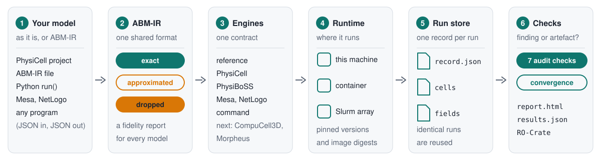

# Architecture

ABMfact runs agent-based models in several simulators behind one interface, and checks their
credibility. Version 0.2 adds the platform core: a shared model description (ABM-IR), one adapter
contract for every engine, a run record and store, runtime backends, a small reference engine, a
PhysiCell and PhysiBoSS adapter, and a convergence check. The v0.1 audit runs on top of all of it
unchanged.



## Engines and their status

| Engine | Runs | ABM-IR translation | Status |
|---|---|---|---|
| `physicell` | PhysiCell 1.14.2 and PhysiBoSS projects, as they are | both ways, with a fidelity report | available |
| `reference` | ABM-IR models, in a built-in 2D simulator | runs ABM-IR directly | available |
| `mesa` | Mesa 3 model classes | not yet | available for audits |
| `netlogo` | NetLogo models through pynetlogo | not yet | available for audits |
| `python` | any `run(params, seed, knobs)` function | not needed | available |
| `command` | any program that reads JSON on standard input and prints JSON | not needed | available |
| `compucell3d` | CompuCell3D 4.10.0 projects, as they are | both ways, with a fidelity report | available |
| `morpheus` | Morpheus 2.4.1 models, as they are | planned next | available |
| Chaste, Agents.jl, BioDynaMo, Tissue Forge, FLAME GPU 2, Repast4Py | | | planned |

## Layers

| Layer | What it does | Where |
|---|---|---|
| Inputs | native project folders, ABM-IR documents, audit files, the Python API and the CLI | `abmfact.ir`, `abmfact.config`, `abmfact.cli` |
| Translate | importers and exporters between native formats and ABM-IR, each with a fidelity report | `abmfact.engines.physicell.translate` |
| Modes | run one model, audit its claims, check convergence | `run-model`, `run`/`check`, `converge` |
| Runtime | where a run executes: this machine, a container, a Slurm job array | `abmfact.runtime` |
| Engines | one adapter contract per simulator, plus the built-in reference engine | `abmfact.engines`, `abmfact.reference` |
| Results | the common output schema, run records and a content-addressed store | `abmfact.records` |
| Credibility | the seven audit checks, convergence and the planted-fault zoo | `abmfact.audit`, `abmfact.verify`, `abmfact.zoo` |

Design rules from the platform plan that the code enforces:

- **Wrap, never re-implement.** Each simulator's own engine does the physics. The reference engine is a
  small baseline for verification, not a competitor.
- **Native first.** A PhysiCell project runs unchanged (fidelity tier T0). Translation (tier T1) is a
  second route, and it always says what it changed.
- **Capabilities are declared.** An engine refuses, with a reason, what it cannot honour, and the audit
  then reports the check as `NOT_TESTABLE` instead of running something else.
- **One run record for everything,** with the engine version or image digest, so a result can be traced
  to the exact build that produced it.

## The adapter contract

Every engine subclasses `abmfact.engines.Engine`:

| Method | Returns |
|---|---|
| `capabilities()` | mechanics, dimensions, diffusion, intracellular formats, GPU, honoured knobs, native formats, ABM-IR features |
| `availability()` | whether the engine can run on this machine, and why not |
| `refuse(model, knobs)` | the reasons it cannot honour a request; empty when it can |
| `prepare(model, params, knobs, seed, workdir)` | a `PreparedRun`: an in-process call, or native files plus a command |
| `run(prepared, backend)` | a `RunHandle` from a backend (local, container or Slurm) |
| `collect(handle)` | a `RunRecord` with outputs in the common schema |

`run_once()` chains the four steps and, with a store, serves an identical earlier request from disk.
Engines are found through the `abmfact.engines` entry point group, so another package can add one:

```toml
[project.entry-points."abmfact.engines"]
myengine = "mypackage.engine:MyEngine"
```

`abmfact engines` lists every engine, its capabilities and whether it is available here. The v0.1
adapters (Python, Mesa, NetLogo, command) are engines too: the audit runs every job through the
contract, and a test checks that each job gives exactly what the adapter gives when called directly.

## Common output schema

| Table | Columns |
|---|---|
| cells | `time, id, type, x, y, z, volume, state` (`state`: 0 live, 1 apoptotic, 2 necrotic) |
| fields | one frame per substrate and saved time: `time, substrate, origin, spacing, values` |
| observables | tidy `time, name, value` |

Observables are computed from these tables by ABMfact (`abmfact.records.observables`), not by each
engine, so the same observable means the same thing whichever engine ran the model. Each run's
observables also become v0.1 outputs, one series per observable plus `time`, so audit claims use the
usual metric grammar, for example `last(cells)`.

## Run records and the store

A `RunRequest` holds everything that decides a run: engine, engine version or image digest, model
hash, parameters, seed, all knobs and what was collected. Its SHA-256 is the run's key. Model hashes and
build keys read text files with LF line endings (`abmfact.digest`), so a Windows checkout with CRLF
endings gives the same identity; hashes that certify the exact bytes on disk (stored outputs, RO-Crate
records) do not normalise. A `RunRecord`
adds the status, wall time, log, output paths and their hashes, warnings and the ABMfact version.

`RunStore` keeps runs under `runs/<key[:2]>/<key>/` with an index for queries. The core writes NumPy,
CSV and a JSON lines index; with `pip install "abmfact[store]"` it writes Parquet, Zarr and DuckDB.
Failed runs are never served from the store. Only one process writes to a store at a time; parallel
audit workers append to a JSON lines index, which is safe for single-line appends.

## Runtime backends

- **local**: in-process calls, native commands as subprocesses with a log and a timeout, and the process
  pool the audit uses.
- **container**: Docker, Podman or Apptainer. The run's work directory is mounted at `/work`, extra
  folders read-only, and the image digest goes into the run record.
- **slurm**: writes one job array (an `sbatch` script plus a manifest of work directories and commands)
  and submits it only when asked.

## Fidelity tiers

| Tier | Meaning |
|---|---|
| T0 | native: the model's own files run unchanged |
| T1 | structural: the same paradigm, concepts mapped one to one (ABM-IR to PhysiCell and back) |
| T2 | calibrated: a different mechanics paradigm, parameters fitted to match observables (milestone 4) |
| T3 | certified: a T1 or T2 translation that passed docking within stated tolerances (milestone 3 onward) |

Every translation writes a fidelity report listing each field as exact, approximated, dropped or
native (custom code that is never translated).
