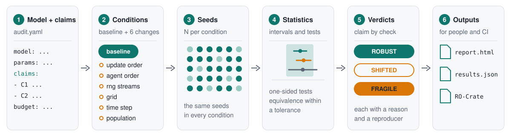

# Getting started

ABMfact reruns an agent-based model under changes that a correct implementation should not care about,
and reports which of the model's stated conclusions survive. This chapter installs it, runs a first
audit and a first biological model, and shows the same steps from Python.

## Install

ABMfact needs Python 3.11 to 3.13. The core depends only on NumPy, SciPy, PyYAML and pydantic.

```bash
pip install abmfact
```

Until a release is on PyPI, install from the repository instead:

```bash
pip install "abmfact @ git+https://github.com/a7med7emedan/ABMfact"
```

Optional parts come as extras, so the core stays small:

| Extra | Adds |
|---|---|
| `mesa` | Mesa models |
| `netlogo` | NetLogo models through pynetlogo (NetLogo itself is installed separately) |
| `store` | Parquet, Zarr and DuckDB storage for the run store |
| `physicell` | reading PhysiCell outputs with pcdl (a SciPy reader works without it) |
| `docs` | the tools that build this manual |
| `all` | `mesa`, `store` and `physicell` |

For example, `pip install "abmfact[mesa,store]"`. Check the install with `abmfact --version`.

## See it work

```bash
abmfact demo --jobs 4
```

This audits the planted-fault zoo: ten small models, eight of them with one realistic bug each. It
prints the detection matrix, which shows each bug caught by the check written for it. See
[the planted-fault zoo](zoo.md) for what the matrix means and how it is tested.

## Audit your own model

An audit is one YAML file: the model, its parameters, the claims to test, and a budget of seeds.

```bash
abmfact init                          # a commented audit.yaml for a Python model
abmfact init --adapter mesa -o audit.yaml --force
abmfact run audit.yaml --out results/
```

`results/report.html` opens in any browser. It shows a verdict for each claim under each check, with
intervals, likely causes and a command that reproduces each run. `results/results.json` holds the same
numbers for scripts. `abmfact check audit.yaml` exits with status 1 when any claim is `FRAGILE` or
`SHIFTED`, so it fits in continuous integration.



The [concepts](concepts.md) page explains knobs, conditions and verdicts. [Writing claims](claims.md)
covers the claim format, and [adapters](adapters.md) covers Python, Mesa, NetLogo and programs in any
language.

## Run a biological model

ABM-IR describes a biological agent-based model once, so that any engine can run it. The repository has
three example models. This runs one in the built-in reference engine:

```bash
abmfact engines                     # which engines run here
abmfact run-model examples/ir/monolayer.yaml --engine reference --out monolayer/
```

On a laptop this takes a few seconds and prints the first and last value of each observable:

```text
  reference: ok in 4.5s, seed 0, run 1e39fdb57578
  cells                          40 at t=0  ->           259 at t=2880
  spread                      41.49 at t=0  ->         98.83 at t=2880
  wrote monolayer
```

An audit file can name an engine and an ABM-IR model instead of a Python function. See
`examples/ir/audit_monolayer.yaml`, and [convergence](convergence.md) for refining the time step and
the voxel size. PhysiCell projects run natively, as described in
[PhysiCell and PhysiBoSS](engines/physicell.md).

## From Python

Everything the command line does is available from Python. An ABM-IR model is a validated pydantic
object, and parameters change by dotted path:

```{doctest}
>>> from abmfact.ir import apply_params, load_model, model_hash
>>> model = load_model(EXAMPLES / "ir" / "monolayer.yaml")
>>> [cell_type.name for cell_type in model.cell_types]
['epithelial']
>>> model.experiment.max_time
2880.0
>>> shorter = apply_params(model, {"experiment.max_time": 600})
>>> shorter.experiment.max_time
600.0
>>> model_hash(shorter) == model_hash(model)
False
```

A claim's metric is a small expression over a run's outputs:

```{doctest}
>>> from abmfact import Metric
>>> Metric.parse("last(cells)").evaluate({"cells": [40, 120, 259]})
259.0
```

An audit runs with {func}`abmfact.config.load_audit` and {func}`abmfact.audit.run_audit`. The
[API reference](api/index.md) documents every public module.
